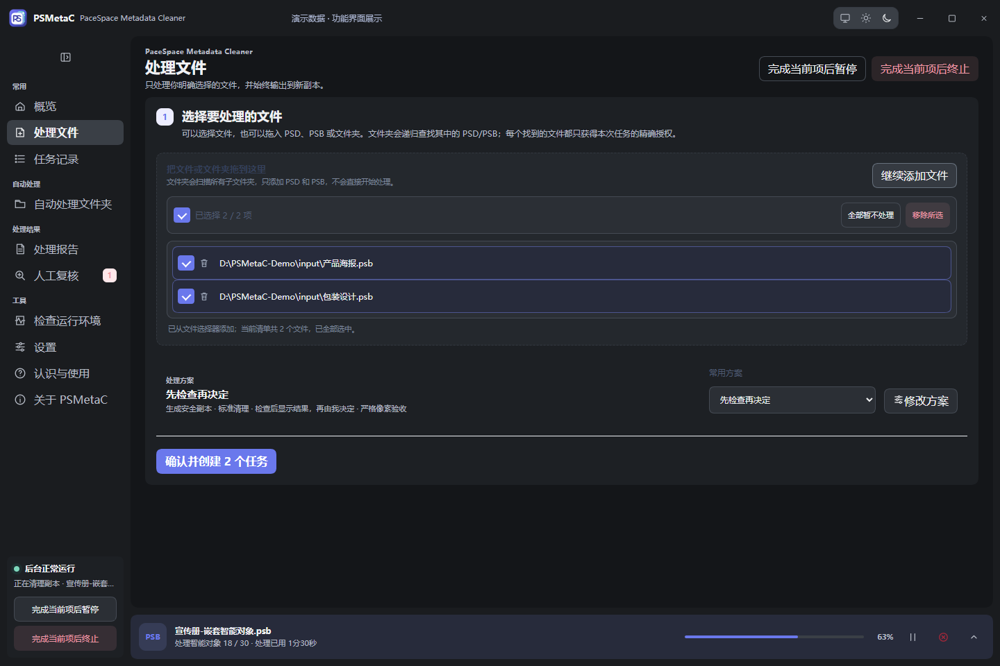
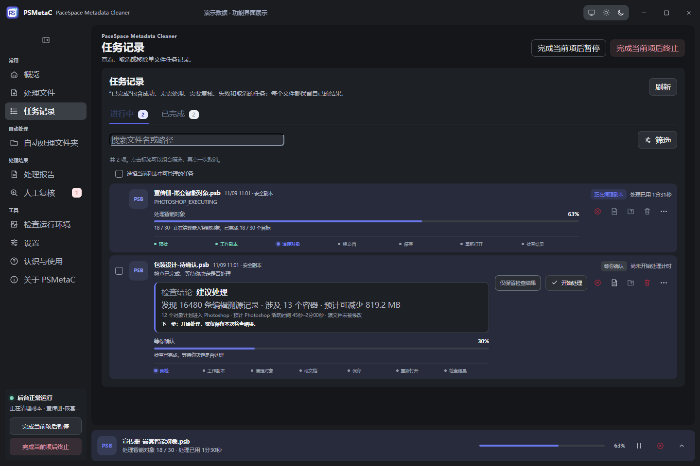
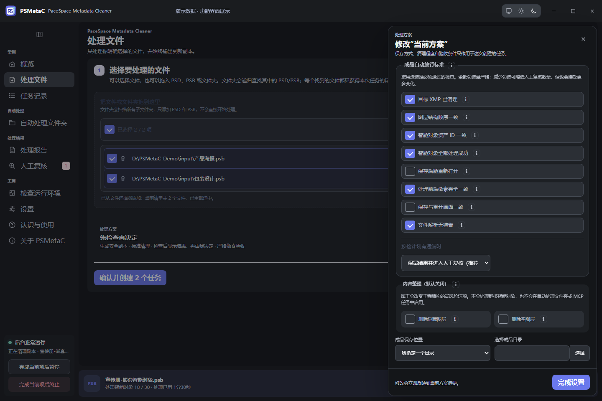
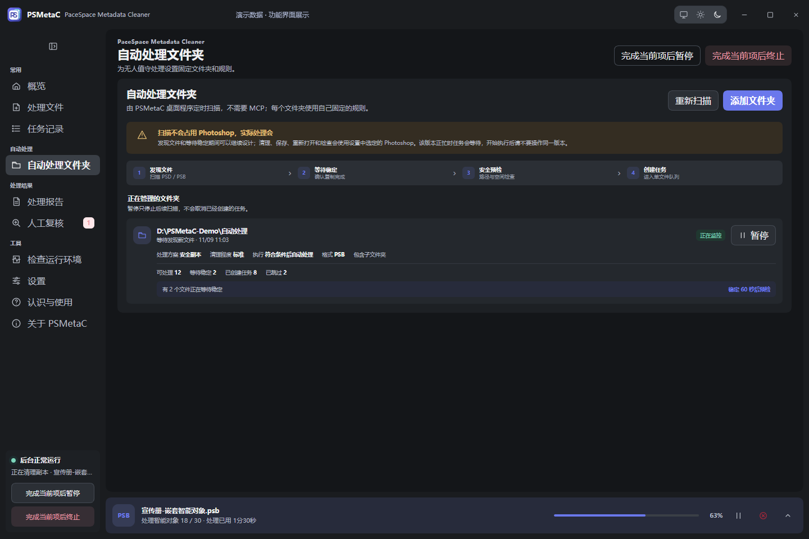
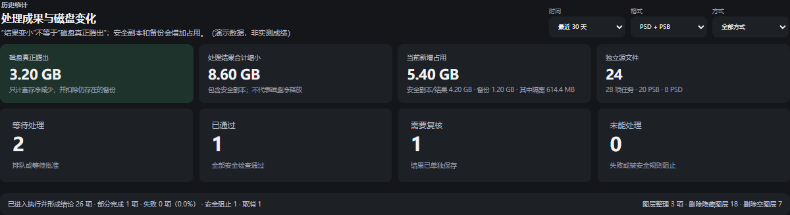

# PSMetaC · PaceSpace Metadata Cleaner

[](https://github.com/Lifezy/PSMetaC/actions/workflows/ci.yml)
[](LICENSE)

清理 Photoshop PSD / PSB 中冗余的 XMP 编辑溯源信息，支持嵌套智能对象、批量任务和处理报告。

A Windows tool for cleaning redundant Photoshop metadata, with smart-object support, batch queues and auditable reports.

**`0.2.0-alpha.6` · Windows 10/11 · 需要已安装 Photoshop · Alpha 测试阶段**



先检查再决定，或按规则批量处理。默认生成安全副本，也可以明确选择直接保存并备份。

<details open>
<summary><strong>批量进度与检查结果</strong>：查看对象处理进度，检查后选择开始处理或仅保留结果</summary>



</details>

<details>
<summary><strong>处理方案与图层整理</strong>：选择验收标准，可选删除隐藏图层和空图层</summary>



</details>

<details>
<summary><strong>自动处理文件夹</strong>：扫描、等待文件稳定，再按固定规则创建任务</summary>



</details>

<details>
<summary><strong>历史统计</strong>：分清实际释放空间、结果缩小与新增副本占用</summary>



</details>

以上截图由当前桌面界面渲染，使用独立的演示数据。文件名、进度、耗时和统计数字均为展示示例，
不代表实测清理效果。截图可通过 `scripts/capture-readme.mjs` 重新生成。

## 功能

- 只读检查：分析容器、XMP、祖先记录和计划对象数，显示检查结果后再决定是否处理。
- 安全副本：在成品盘建立工作副本，校对所选项目后发布；未通过的结果进入人工复核。
- 直接保存：显式选择后覆盖原文件，可先备份；部分对象失败时仍保存已完成项，并标记“部分完成、未校对”。
- 队列：完成当前文件后暂停或终止，支持文件稳定等待、重复任务保护和自动文件夹扫描。
- 图层整理：手动安全副本任务可选删除根文档隐藏图层和普通空像素层，默认关闭，实际删除后要求人工复核。
- 统计与报告：分别统计实际释放空间、结果体积缩小和新增副本占用；提供 HTML / JSON / JSONL 证据。
- 桌面与 MCP：中文亮暗主题、托盘、本地命名管道和受控 stdio 工具，不开放 MCP 网络端口。

## 开发环境

| 环境 | 要求 |
|---|---|
| 操作系统 | Windows 10/11 x64 |
| Node.js | 建议 24 LTS，最低 22.18 |
| 包管理器 | `package.json` 固定的 pnpm 版本 |
| Photoshop | 使用桌面模式安装，具备 COM / JSX 自动化能力；已记录验证范围为 26.11 |
| 打包 | Electron 43.2.0、electron-builder 26.11.1，依赖锁定在 `pnpm-lock.yaml` |

PSD 仍需显式开启实验功能，PSD 无人值守另行启用。其他 Photoshop 版本可以尝试运行，
报告会记录版本状态；不能把启动或单次保存成功当作完整兼容性验证。

## 快速开始

```powershell
git clone https://github.com/Lifezy/PSMetaC.git
cd PSMetaC
pnpm install --frozen-lockfile
pnpm test
pnpm run verify:package
pnpm run desktop
```

首次启动时选择软件数据目录。先在专用测试副本上使用“先检查再决定”，核对预计清理量、
目标数和输出位置后再处理。自动清理期间 Photoshop 会被任务使用，应等待任务安全结束。

## 命令行与 MCP

以下路径只是示例，请换成自己的测试目录：

```powershell
node src/cli.ts init --data-dir D:\PSMetaCData --input-root D:\PSMetaC-Sandbox\input --output-root D:\PSMetaC-Sandbox\output
node src/cli.ts serve --data-dir D:\PSMetaCData
```

在另一个终端执行只读检查：

```powershell
node src/cli.ts preflight --data-dir D:\PSMetaCData --file D:\PSMetaC-Sandbox\input\sample.psb
```

MCP 客户端连接 `src/mcp.ts`，或使用安装版的 `resources/scripts/psmetac-mcp.cmd`。
桌面程序或 `serve` 必须保持运行。具体参数见 [MCP 文档](docs/MCP.md)。

## 构建 Windows 安装包

```powershell
pnpm run verify:package
pnpm test
pnpm run pack:win
pnpm run verify:dist -- --require-installer
pnpm run smoke:mcp
```

产物位于 `dist/`。安装器使用当前用户范围；首次构建可能下载 Electron 和 NSIS。
`verify:dist` 会校验 EXE、ASAR 完整性资源、内置脚本与版本一致性。
现有 alpha 构建未签名；源码发布不会把旧的本地安装包作为新的已验收 Release 上传。

## 验证与已知边界

- 自动测试使用临时目录，不启动 Photoshop；验证状态机、路径授权、账本、策略、报告、恢复与空间规划。
- 开源快照已通过 82 项自动测试、GitHub Windows CI、NSIS 构建和打包 MCP 冒烟测试。
- 实际 Photoshop 工作流需要隔离样本实机验证，尤其是智能滤镜慢开、深层嵌套、大文件保存和取消。
- 保存期间取消属于合作请求，不能覆盖 Photoshop 正在执行的保存指令。
- 安全副本保留源文件；直存模式会覆盖源文件，未备份时无法由本工具回滚。
- 内容整理会有意改变工程结构，且当前仅支持根文档保守规则。
- 默认校对处理前后画面，保存后重新打开是可选的高成本检查。

完整状态和流程见 [架构](docs/ARCHITECTURE.md)、[报告](docs/REPORTS.md) 和
[运行说明](docs/OPERATIONS.md)。本版变化见 [更新说明](docs/RELEASE-NOTES-0.2.0-alpha.6.md)。

## 目录

```text
src/        桌面、任务服务、队列、报告、CLI 与 MCP
vendor/     本项目 Photoshop 检查和清理脚本的固定哈希快照
scripts/    构建、校验、界面验收和合成样本工具
tests/      不启动 Photoshop 的自动测试
fixtures/   不含工程文件的指标基线和合成任务模板
build/      图标和安装器源资源
docs/       公开的架构、操作和接口文档
.github/    Windows CI 与问题模板
```

`vendor/psb_batch_tool` 的四个脚本随源码自包含分发，清单固定其 SHA-256；修改后需同步
清单并复核。`fixtures/*.tsv` 中的路径必须先改成自己的隔离目录，合成脚本会操作 Photoshop。

## 参与与许可证

欢迎提交可复现的问题或 Pull Request，见 [贡献指南](CONTRIBUTING.md)。
安全问题和敏感样本处理见 [SECURITY.md](SECURITY.md)。提交 Issue 前移除真实文件名、
绝对路径、机器名及客户信息，优先使用合成样本。

源码采用 [MIT 许可证](LICENSE)。依赖与商标说明见 [THIRD_PARTY_NOTICES.md](THIRD_PARTY_NOTICES.md)。
本项目不隶属于 Adobe，使用者需自行安装并获得 Photoshop 的合法使用权。
